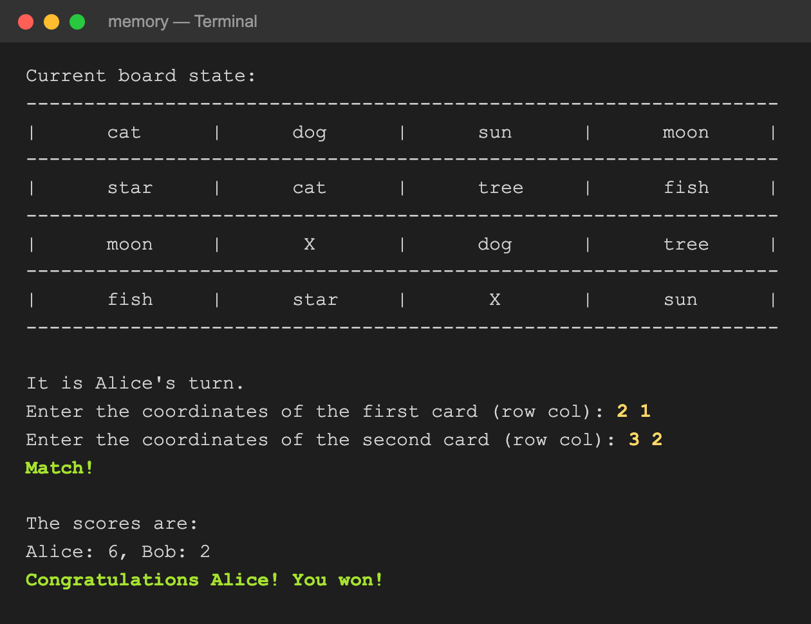
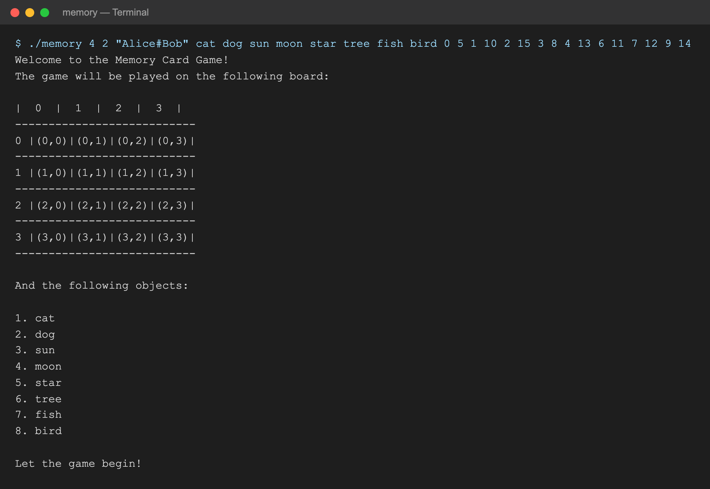
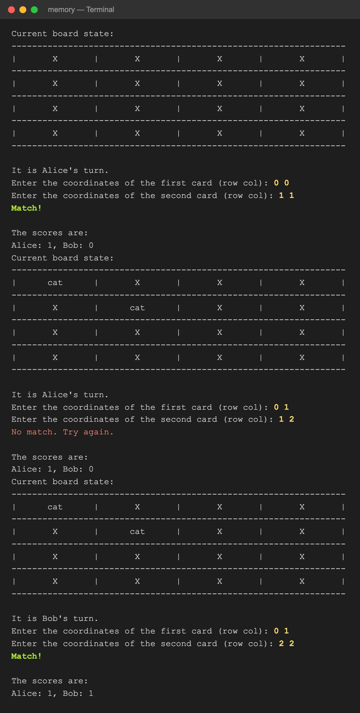
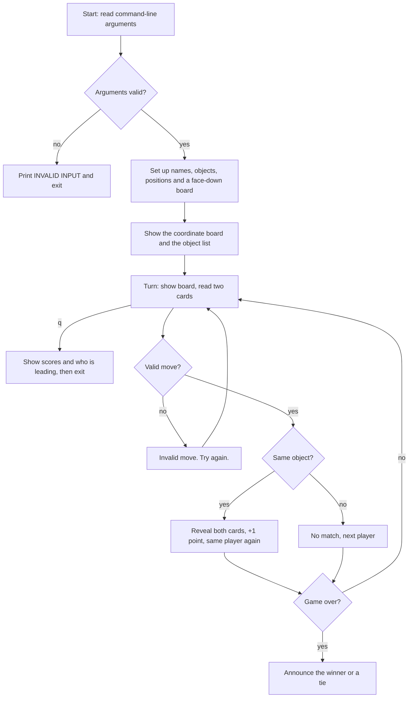

# The Memory Game

A command-line **memory card game** in C for 1 to 10 players. Cards are laid face down on an *n × n* board; players take turns flipping two cards, and keep their turn as long as they find matching pairs. Everything about the game is set from the command line: the board size, the players, the objects to match and where each one is hidden.

<p align="center">
  
</p>

## Contents

- [Quick start](#quick-start)
- [Command-line arguments](#command-line-arguments)
- [How a game goes](#how-a-game-goes)
- [Rules](#rules)
- [Architecture](#architecture)
- [Input validation](#input-validation)

## Quick start

The program uses C99 variable-length arrays, so compile it as C99 or newer:

```bash
cc -std=c99 -Wall -o memory "The Memory Game.c"
```

A 4 × 4 game for Alice and Bob with eight pairs:

```bash
./memory 4 2 "Alice#Bob" cat dog sun moon star tree fish bird 0 5 1 10 2 15 3 8 4 13 6 11 7 12 9 14
```

The first number is the board size. The smallest possible game is a 2 × 2 board with two pairs:

```bash
./memory 2 2 "Alice#Bob" cat dog 0 1 2 3
```

## Command-line arguments

```
./memory <n> <players> "<name1#name2#...>" <object 1> ... <object n²/2> <position 1> ... <position n²>
```

| Argument | Meaning | Example |
|---|---|---|
| `n` | Board size: the board is *n × n* (at least 2) | `4` |
| `players` | Number of players, 1 to 10 | `2` |
| names | Player names separated by `#`, exactly `players` of them | `"Alice#Bob"` |
| objects | *n²/2* object names, one per pair | `cat dog sun moon star tree fish bird` |
| positions | *n²* cell numbers: two per object, in the same order as the objects | `0 5 1 10 2 15 ...` |

**Positions** number the cells from 0 to *n² − 1*, row by row, so cell number = `row × n + column`. On a 4 × 4 board, cell 5 is row 1, column 1. Every cell must be used exactly once.

In the example above, `0 5` places the two `cat` cards at cells 0 and 5, `1 10` places the two `dog` cards at cells 1 and 10, and so on.

Object names are shown on the board in a 15-character cell and should be at most 7 characters long.

## How a game goes

**1. Setup.** The program shows the board with every cell's coordinates, then the objects in play.

<p align="center"></p>

**2. Turns.** Each turn shows the current board (`X` is a face-down card), then asks the current player for two cards. Type each card as **row and column on one line**, e.g. `0 1`, and press Enter. A match reveals both cards and scores a point, and the same player goes again. A miss passes the turn to the next player.

<p align="center"></p>

**3. The end.** When the game is over, the program announces the winner or a tie (top of this page).

**Stopping early.** Type `q` at any card prompt to stop the game. The program shows who stopped it, the scores so far and who is leading:

```
Enter the coordinates of the first card (row col): q

Game stopped by Bob.
The scores are:
Alice: 0, Bob: 2
Bob is leading.
```

## Rules

- Players take turns in the order their names were given.
- Each card is entered as row and column on the same line. If only one number (or nothing) is typed, the program asks again: `Please enter row and column on the same line, e.g. 0 1`.
- Typing `q` at any card prompt stops the game and shows the scores.
- Finding a pair scores 1 point and gives the same player another turn.
- A move is rejected with **"Invalid move. Try again."** and the player enters it again if:
  - a coordinate is outside the board (below 0, or *n* or more);
  - both cards are the same cell;
  - either card has already been matched;
  - the input isn't two numbers.
- The game ends when every pair has been found.
- The player with the most pairs wins. If two or more players share the highest score, it's a tie.

## Architecture

The program is a single C file, organized into small functions by responsibility.



### Functions

| Area | Functions | What they do |
|---|---|---|
| Input validation | `checkInvalidInput`, `checkNumOfPlayers`, `checkPositionsInput` | Check the argument count, the player names and the positions (see [Input validation](#input-validation)) |
| Setup | `fillPlayersNames`, `fillObjectsNames`, `insertObjectsPositions`, `switchGameBoardToX`, `initializationMatchArray` | Build the game's arrays from the arguments and start with every card face down |
| Display | `printBoardStart`, `printObjectsList`, `printDynamicGameBoard` | Print the coordinate board, the object list, and the current board with names centered in their cells |
| Turns | `gameProcess`, `readCoordinates`, `checkIfMatch` | Run one turn: read and validate the two cards, look for a match, update the board and the scores, and pass the turn on a miss |
| Input and quitting | `readCoordinates`, `stopGame` | Read one card per line (row and column together), ask again if only one number is typed, and stop the game with the current scores on `q` |
| End of game | `checkWinner`, `maxScore`, `checkEndGame` | Decide when the game is over and who won |

### Data

| Variable | Shape | Holds |
|---|---|---|
| `gameBoard` | `char *[n][n]` | What each cell shows: a pointer to `"X"` or to the matched object's name. Nothing is copied |
| `positionsArray` | `int [n²/2][2]` | The two cell numbers of each object |
| `positionsMatchArray1`, `positionsMatchArray2` | `int [n²/2]` | The cells already matched, so they can't be picked again (`-1` = not yet) |
| `namesArray` | `char *[10][…]` | Pointers to the player names, split out of the `#`-separated argument with `strtok` |
| `playersScore` | `int [players]` | Pairs found by each player |

**Key ideas**

- **One number per cell.** A card's `row` and `col` are combined into a single cell number, `row × n + col`, the same numbering the positions use on the command line. Finding a match is then just checking whether both chosen cell numbers belong to the same object in `positionsArray`.
- **No copies of strings.** Names and objects stay where the operating system put the command-line arguments; the arrays only hold pointers to them.
- **Sized at run time.** The arrays are C99 variable-length arrays sized from *n* and the number of players, which is why the arguments are checked before anything else happens.

## Input validation

The program prints `INVALID INPUT` and exits if:

| Problem | Example |
|---|---|
| Missing or extra arguments: there must be exactly 3 + *n²/2* + *n²* after the program name | `./memory 4` |
| Board size below 2 | `./memory 1 ...` |
| Number of players outside 1 to 10 | `./memory 2 0 ...` |
| Number of names doesn't match the number of players | `./memory 2 3 "Alice#Bob" ...` |
| A position is repeated, negative, or larger than *n² − 1* | `... 0 0 1 2` |

## Author

Jonathan Hadar ([@JonHadar](https://github.com/JonHadar))
